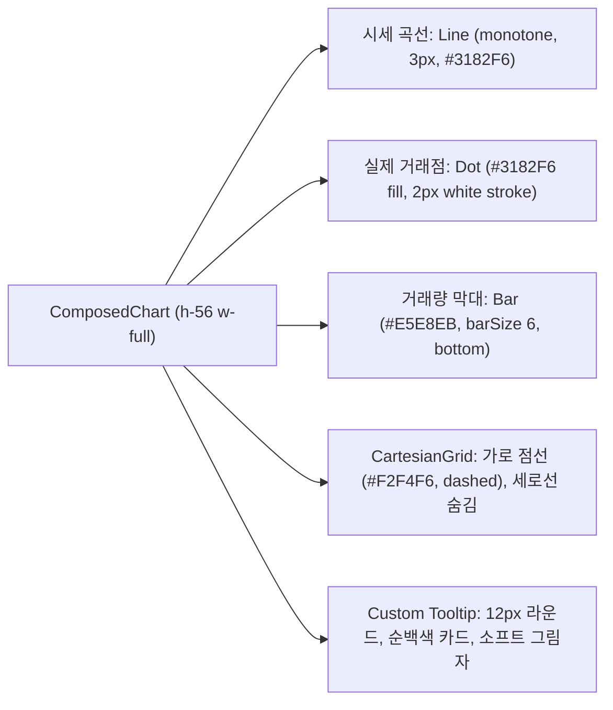

# [디자인 가이드라인] 토스(Toss) 인터페이스 & 반응형 디자인 스펙 (DESIGN.md)

> **디자인 철학**: "극도의 절제미, 정갈한 카드 모듈, 실시간 리액티브 반응, 군더더기 없는 타이포그래피"

---

## 1. 토스 디자인 토큰 체계 (Color & Surface Tokens)

### 1.1 기본 색상 체계 (Palette)
> 실제 값의 SSOT는 `src/app/globals.css`의 `:root` CSS 변수이며, Tailwind 토큰(`tailwind.config.ts`)이 이를 참조합니다.

- **Brand Accent (토스 블루)**: `#0064FF` (`bg-brand`, `text-brand`, `border-brand`)
- **Brand Hover / Light**: `bg-brand-hover`, `bg-brand-light` (`#EBF3FF` 계열)
- **연한 색 (투명도 대신, 2026-10-27)**: 아주 연한 배경 `bg-brand-subtle`, 연한 테두리 `border-brand-line`(브랜드 25%, 펼친 칸·선택 카드), 강조 테두리 `border-brand-line-strong`(45%, hover), 그림자 `shadow-brand-glow`, 주의 박스 테두리 `border-status-caution-line`. 테마 5종 모두 브랜드색에서 자동 계산(`globals.css`). `/30` 같은 투명도 표기는 변수 색이라 그려지지 않으므로 금지
- **Canvas (페이지 배경)**: `#F2F4F6` (`bg-surface-page`)
- **Card (카드 배경)**: `#FFFFFF` (`bg-surface-card`)
- **Subtle Surface (내부 컨테이너)**: `#F9FAFB` (`bg-surface-subtle`)
- **Borders**:
  - 기본 테두리: `#E5E8EB` (`border-border-default`)
  - 연한 테두리: `#F2F4F6` (`border-border-light`)
- **Typography Scale & Colors**:
  - Primary: `#191F28` (`text-text-primary`) - 헤드라인 및 주요 수치
  - Secondary: `#4E5968` (`text-text-secondary`) - 본문 및 서브 레이블
  - Tertiary: `#8B95A1` (`text-text-tertiary`) - 부가 설명, 날짜, 단위
- **Status (의미 고정 색, 2026-10-22 추가)**: 브랜드 테마와 무관하게 의미가 같다
  - Good `#0A9B62` / light `#E7F6EF` (`bg-status-good`, `bg-status-good-light`) - 추천 구간
  - Caution `#E5A100` / light `#FFF6DE` (`bg-status-caution`, `bg-status-caution-light`) - 주의 구간 (노랑 위 글자는 `text-text-primary`)
  - Risk `#E5484D` / light `#FDECEC` (`bg-status-risk`, `bg-status-risk-light`) - 매칭 어려움 구간
  - 복비 슬라이더 4색 구간: 파랑(`bg-brand`, 법정 상한 80~100%) · 초록 · 노랑 · 빨강, 하한(30%) 아래는 `--border-default` 빗금

---

## 2. 호갱노노 + 토스 결합 차트 명세 (Hokim + Toss Chart Spec)

컴포넌트: `src/components/analysis/HokimTradeChartCard.tsx` (Recharts `ComposedChart`)



1. **시세 곡선 (Line)**:
   - 딱딱한 직선 대신 `type="monotone"` 적용.
   - 두께는 `strokeWidth={3}`, 색상은 토스 블루 `#3182F6`.
2. **거래 포인트 (Dot)**:
   - 원형 점의 배경은 `#3182F6`, 외곽 테두리는 `stroke="#FFFFFF"` `strokeWidth={2}`로 곡선 위에서 명확히 분리.
3. **월별 거래량 (Bar)**:
   - 차트 하단에 위치하며, 높이가 시세선과 겹치지 않도록 미니 막대(`barSize={6}`)로 배치. 색상은 방해를 최소화하는 `#E5E8EB`.
4. **축(Axis) 및 여백 최적화**:
   - 세로 Y축 텍스트는 숨김(`hide={true}`) 처리하여 모바일 좌우 여백을 100% 차트 선으로 확장.
   - X축은 `tickLine={false}`, `axisLine={false}`, 텍스트 색상은 `#8B95A1` (11px).

---

## 3. 끝장 투표 [상하 분리형 카드] 명세 (Debate Poll Button Spec)

컴포넌트: `EndgameDebatePoll.tsx` & `DebateBottomSheetModal.tsx`

```
┌──────────────────────────────────────────────┐
│  🔥 무조건 10억 찍는다           [ 내 선택 ]  │  ← 상단: 선택지 라벨 + 뱃지
│                                              │
├──────────────────────────────────────────────┤  ← 구분선 (border-border-light)
│  68%                                  313표  │  ← 하단: 투표 후 수치 (투표 전: 🔒 투표 시 결과 공개)
└──────────────────────────────────────────────┘
```

- **상하 분리형 레이아웃 원칙**:
  - `min-h-[74px] flex flex-col justify-between p-3 rounded-xl border`
  - 상단에 선택지 명칭을 두고, 하단에 결과 수치(퍼센트와 표수)를 완전히 분리하여 모바일 360px에서도 텍스트가 줄바꿈되면서 퍼센트와 겹치는 현상(유저 제보 버그)을 원천 방지.
  - 투표 전에는 하단에 `🔒 투표 시 결과 공개`가 노출되어 정보 공백(Curiosity Gap) 유발.
  - 투표 완료 시 선택된 버튼은 `border-brand bg-white`로 활성화되며 내부에 부드러운 게이지(`bg-brand/15`)가 차오름.

---

## 4. 모바일 반응형 뷰포트 규격 (Viewport Breakpoints)

- **최소 뷰포트 (360px × 740px)**: 삼성 갤럭시 A55, 갤럭시 S 시리즈
  - 가로 스크롤(`overflow-x`) 절대 발생 금지.
  - 평형대 4개 칩 및 층수 3단 세그먼트 바가 한 줄에 온전히 표시되어야 함.
- **기준 뷰포트 (390px × 844px)**: 애플 아이폰 14 / 15 / 16 표준
  - 첫 화면에서 평형/층수 컴팩트 바로 인해 복비 시뮬레이터 상단 앵커(`AI 추천 적정 복비 시뮬레이터`)가 무스크롤로 시야에 들어와야 함.
- **최소 터치 타깃**: 모든 클릭 가능한 버튼 및 칩은 `min-h-[44px]` 이상(또는 패딩 포함 44px 이상 터치 영역) 확보.

---

## 5. 🎨 토스 라이트 단일 고정 디자인 시스템 (Toss Light Permanent Lock)

대표님의 최종 정책에 따라 **'토스 라이트(Toss Light)' 단일 디자인으로 영구 확정**되었으며, 실험용 테마 전환 시스템(Theme Switcher)은 안전하게 폐기되었습니다.

### 5.1 토스 라이트 디자인 원칙
1. **토스 블루 (#0064FF)**: 핵심 액션 버튼(`bg-brand`), 활성화된 세그먼트, 하이라이트 배지, 주요 텍스트에만 절제하여 사용.
2. **토스 서피스 (#F2F4F6, #FFFFFF)**: 눈에 피로를 주지 않는 깔끔하고 부드러운 그레이 백그라운드와 화이트 카드.
3. **타이포그래피 (Pretendard)**: `letter-spacing: -0.02em`, 과도한 볼드를 지양하고 700(Bold)/800(Extrabold)을 정보 위계에 맞게 엄격히 제한.
4. **Anti-AI-slop**: 불필요한 글래스모피즘, 화려한 보라색/무지개 그라데이션, 이모지 남용을 완전히 배제하고 신뢰성 높은 핀테크 감성 유지.

### 5.2 동적 평형 선택 칩 그리드 레이아웃
- 각 단지의 실제 거래 평형 수에 따라 자동으로 최적의 그리드 컬럼이 적용됩니다:
  - 1개 평형: `grid-cols-1`
  - 2개 평형: `grid-cols-2` (예: 힐스테이트다산 30평/34평)
  - 3개 평형: `grid-cols-3` (예: 다산자이아이비플레이스 34평/39평/41평)
  - 4개 평형: `grid-cols-4` (기본 폴백 24평/30평/34평/38평)
- 모바일 360px ~ 390px 뷰포트에서도 가로 스크롤 없이 시원한 터치 영역(`min-h-[44px]`)을 보장합니다.

---

## 6. 🎞️ 모션 (대표님 확정 2026-10-25)

효과는 **"눌렸다·생겼다·바뀌었다"를 알려 줄 때만** 쓴다. 정보 화면이라 장식 효과는 시선을 뺏고 오래된 휴대폰에서 버벅인다.

| 쓰는 곳 | 효과 | 토큰 |
|---|---|---|
| 거래 페이지를 열 때 기록 줄 | 스태거: 줄마다 0.05초 간격으로 아래에서 올라옴 (최대 8줄, 0.4초 안) | `animate-rise-in` + `staggerDelay(i)` (`src/lib/motion.ts`) |
| 새 기록 한 줄, 지금 할 일 카드가 바뀔 때 | 슬라이드 인 (8px 아래 → 제자리, 투명 → 보임) | `animate-rise-in` |
| 모든 버튼 | 누름 축소 | `active:scale-96 transition-transform duration-fast ease-out-soft` |
| 집주인 확인 순간 (가계약·계약·잔금 확인됨) | 체크 선 그리기, 한 번만 | `animate-check-draw` (SVG path `stroke-dasharray: 24`) |
| 목록 카드 색 띠 상태가 바뀔 때 | 배경·글자 색 전환 | `transition-colors duration-base ease-out-soft` |

- 길이는 0.12~0.35초(`duration-fast 120ms` · `base 200ms` · `slow 320ms`)만 쓰고, 곡선은 `ease-out-soft`(cubic-bezier(0.2, 0.8, 0.2, 1)) 하나만 쓴다.
- **쓰지 않음**: 마키, 패럴랙스. **보류**: 카운트업(보여 줄 실제 큰 숫자가 생기면 다시 판단, 가짜 숫자 금지).
- 휴대폰에서 "동작 줄이기"를 켠 사람에게는 `globals.css`의 `prefers-reduced-motion`이 모든 애니메이션·전환을 끈다. 분석 화면의 Framer Motion은 아직 이 규칙 밖이다(정리 대상).

